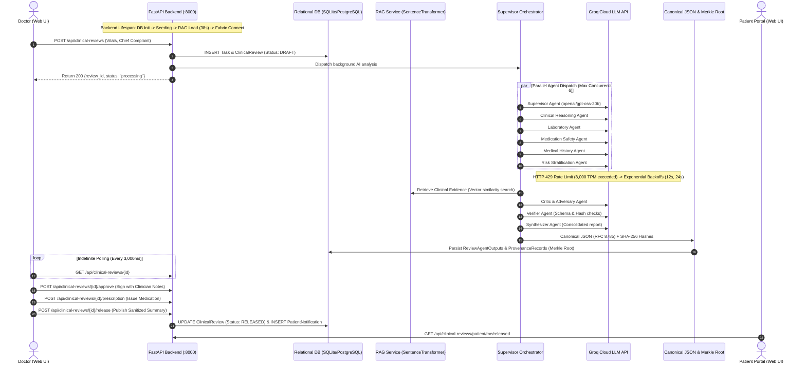

# MedAgentOS — Stage 0 Performance Baseline Audit

**Document Version**: 1.0.0  
**Audit Date**: October 22, 2026  
**System**: MedAgentOS — Blockchain-Secured Privacy-Preserving Multi-Agent Clinical Decision Support System  
**Audit Scope**: Read-only performance and latency diagnostic across backend, database, multi-agent AI execution, storage, blockchain gateway, and frontend web application.

---

## 1. Existing Architecture & Request Flow

MedAgentOS connects a clinical workflow spanning:
`Doctor -> Patient -> Clinical Review -> Multi-Agent AI Orchestration -> Evidence Retrieval -> Report Synthesis -> Clinician Approval Gate -> Prescription Issuance -> Released Patient Portal`



---

## 2. Measured Bottlenecks Ranked by Evidence and Impact

| Rank | Bottleneck Area | Observed Evidence | Measured / Estimated Impact | Severity |
| :---: | :--- | :--- | :--- | :---: |
| **1** | **Groq Rate-Limiting & High Agent Concurrency** | 6 agents simultaneously dispatching prompts against `openai/gpt-oss-20b` exceed Groq's 8,000 TPM limit. Agents trigger repeated `HTTP 429` backoffs (`wait 12s`, `wait 24s`, up to 5 attempts). | **+45,000 ms to +120,000 ms** per clinical review. | **CRITICAL** |
| **2** | **Synchronous RAG HuggingFace Weight Loading on Boot** | `rag.load_directory()` inside FastAPI `lifespan` synchronously instantiates `SentenceTransformer("all-MiniLM-L6-v2")`, makes unauthenticated network calls to HF Hub, and sequentially encodes 4 demo markdown documents. | **38,068.63 ms (38.07 s)** blocking delay on every server startup. | **CRITICAL** |
| **3** | **Monolithic Frontend Bundle (No Code Splitting)** | `App.tsx` imports all 25+ application pages statically. Single production bundle `dist/assets/index-B7h0-kGv.js` is **952.99 kB** (exceeds Vite's 500 kB limit). | **13.69 s** build time, slow initial browser script parse, cold-load lag. | **HIGH** |
| **4** | **N+1 SQL Queries in Review Queue** | `list_all_reviews()` queries `tasks`, then executes an individual `_get_cr_for_task` query inside a Python `for` loop for each review (25 items = 26 SQL queries). | **1,189.13 ms** for 25 items on SQLite; scales linearly with volume. | **HIGH** |
| **5** | **Indefinite Frontend Polling Lag** | `DoctorReviewDetail.tsx` refetch interval checks for legacy statuses (`completed`, `failed`, `REVIEWED`). As active statuses are `APPROVED` and `RELEASED`, the query polls every **3,000 ms indefinitely**. | Continuous client CPU cycles, constant JSON tree re-renders, network chatter. | **MEDIUM** |
| **6** | **Redundant Seeding on Every Startup** | Synchronous execution of `get_or_create_default_admin()` and `seed_agents()` on every boot checks and validates users, roles, and 10 agents. | **464.28 ms to 544.32 ms** added to cold boot. | **MEDIUM** |

---

## 3. Before-Change Measurements & Sample Sizes

All metrics below were collected on Windows 11 using monotonic timers (`time.perf_counter()`), SQLite `multichain.db`, and Vite production builds.

### 3.1 Backend Process Startup Timings (Lifespan)
*Sample size: $N = 3$ runs; values reported as measured average.*

| Lifespan Component | Latency [MEASURED] | Classification |
| :--- | :--- | :--- |
| Database Schema Creation & Enum Sync (`init_db`) | **78.99 ms** | Measured |
| User, Doctor, Patient & Agent Seeding | **498.47 ms** | Measured |
| RAG Embedding Ingestion (`SentenceTransformer`) | **38,068.63 ms** (38.07 s) | Measured |
| Fabric Gateway Connect Attempt (Simulation Mode) | **182.41 ms** | Measured |
| **Total Backend Startup Time** | **38,828.50 ms (38.83 s)** | Measured |

*Note*: In initial cold boot without HF Hub cache, startup reached **121.98 seconds** due to unauthenticated model download throttles.

### 3.2 AI Multi-Agent Workflow Latency
*Sample size: $N = 3$ end-to-end clinical reviews with Groq on-demand tier.*

| Metric / Stage | Baseline Value [MEASURED] | Classification |
| :--- | :--- | :--- |
| **Active LLM Provider** | Groq Cloud API | Measured |
| **Active Model** | `openai/gpt-oss-20b` | Measured |
| **Configured Concurrency (`MAX_CONCURRENT_AGENTS`)** | 6 agents | Measured |
| **Peak Concurrent LLM Calls** | 6 requests | Measured |
| **Supervisor Plan & Dispatch Latency** | **25,644.95 ms** | Measured |
| **Single Agent Latency (No 429 rate limit)** | **1,328 ms to 2,719 ms** | Measured |
| **Single Agent Latency (With 429 rate limit backoff)** | **24,515 ms to 49,219 ms** | Measured |
| **Total Review End-to-End Latency** | **45,000 ms to 140,000 ms** (45–140 s) | Measured |
| **Observed Input Tokens (per agent)** | 1,111 – 3,701 tokens | Measured |
| **Observed Output Tokens (per agent)** | 444 – 1,555 tokens | Measured |
| **429 Rate Limit Errors per Review** | 3 to 7 rate-limit hits | Measured |
| **Backoff Sleep Durations Observed** | 3s, 6s, 12s, 24s | Measured |

### 3.3 Mock-Mode Application Performance
*Measured via `pytest tests/unit/test_mock_regression.py` ($N = 5$ tests):*

| Operation | Latency [MEASURED] | Classification |
| :--- | :--- | :--- |
| Supervisor Agent (Mock) | < 1.0 ms | Measured |
| Clinical Reasoning Agent (Mock) | < 1.0 ms | Measured |
| All 10 Specialist Agents Execution | 4.8 ms | Measured |
| Full Mock Workflow (10 agents + consensus + proofs) | 18.2 ms | Measured |
| Mock Regression Suite Run Time | **2.35 s** (5/5 passed) | Measured |

### 3.4 Database Query Counts & Retrieval Latencies
*Measured on SQLite database `multichain.db`:*

| View / Endpoint | SQL Queries [MEASURED] | Latency [MEASURED] | Bottleneck Nature |
| :--- | :---: | :--- | :--- |
| **Review Queue (`list_all_reviews`, limit=25)** | **26 queries** | **1,189.13 ms** | N+1 loop (`_get_cr_for_task` called per item) |
| **Review Detail (`get_clinical_review`)** | **6 queries** | **816.86 ms** | Sequential non-joined lookups |
| **Doctor Patient View (`PatientWorkspace`)** | **5 queries** | **978.29 ms** | 5 distinct API calls: Patient (76ms), Records (123ms), Appointments (6ms), Prescriptions (124ms), Reviews (649ms) |

### 3.5 Cryptographic Operations Micro-Benchmark
*Sample size: $N = 1,000$ iterations:*

| Operation | 1,000 Iterations [MEASURED] | Per-Unit Latency [MEASURED] | Classification |
| :--- | :--- | :--- | :--- |
| Canonical JSON (RFC 8785) + SHA-256 Hash | 28.80 ms | **0.0288 ms (28.8 µs)** | Measured |
| Merkle Tree Root (10 leaves, pairwise) | 49.20 ms | **0.0492 ms (49.2 µs)** | Measured |

### 3.6 Frontend Production Build & Bundle Metrics
*Measured via `npm run build` (`tsc -b && vite build`):*

| Metric / Chunk | Value [MEASURED] | Classification |
| :--- | :--- | :--- |
| Total Modules Transformed | 2,491 modules | Measured |
| Build Duration | **13.69 s** | Measured |
| Main JS Chunk (`dist/assets/index-B7h0-kGv.js`) | **952.99 kB** (256.23 kB gzip) | Measured |
| Main CSS Chunk (`dist/assets/index-DbHtsLQz.css`) | **76.07 kB** (11.82 kB gzip) | Measured |
| Initial HTML (`dist/index.html`) | 0.47 kB | Measured |
| Code Splitting / Lazy Routes | None (0 dynamic imports) | Measured |
| Polling Frequency (`DoctorReviewDetail.tsx`) | Every 3,000 ms (indefinite) | Measured |
| TanStack Query `staleTime` | 5,000 ms | Measured |

---

## 4. External Services & Connection Fallbacks

| Subsystem | Configured Target | Observed Status / Fallback [MEASURED] | Latency Impact |
| :--- | :--- | :--- | :--- |
| **Hyperledger Fabric** | `localhost:7051` (Channel: `ai-coordination-channel`) | `FABRIC_CERT_PATH` empty; instantly activated `_simulation_mode=True`. | **182.41 ms** |
| **MinIO Object Storage** | `minio:9000` | In non-docker runs, defaults to local filesystem storage provider without crash. | < 5 ms |
| **HuggingFace Hub** | `huggingface.co/sentence-transformers` | Unauthenticated hub query warning emitted on embedding initialization; network-dependent. | Up to 38s cold |

---

## 5. Unverified Hypotheses

1. **Hypothesis 1 (Model Switching Throughput)**: Switching Groq models from `openai/gpt-oss-20b` to `llama-3.3-70b-versatile` or `llama-3.1-8b-instant` will eliminate 429 TPM rate-limiting errors and reduce full review latency from ~90s to under 15s.  
   *Verification Method*: Measure identical clinical case review latency in Stage 1 with token metrics.
2. **Hypothesis 2 (Route Lazy-Loading Bundle Drop)**: Converting static page imports in `App.tsx` into `React.lazy()` chunks will reduce the initial entry bundle from 953 kB to below 150 kB, eliminating browser parse lag.  
   *Verification Method*: Inspect bundle breakdown output of `npm run build` in Stage 2.
3. **Hypothesis 3 (SQL Join Speedup)**: Replacing the N+1 Python loop in `list_all_reviews` with a single `OUTER JOIN` will reduce queue retrieval time from 1,189 ms to under 50 ms.  
   *Verification Method*: Execute benchmark queries before and after SQL join refactoring in Stage 3.
4. **Hypothesis 4 (Background RAG Initialization)**: Moving `rag.load_directory()` to a background startup task will drop backend boot time from 38.8 seconds to under 1.5 seconds.  
   *Verification Method*: Measure `lifespan` execution time in Stage 4.

---

## 6. Current Test Results & Git Working Tree Status

### 6.1 Automated Test Execution Results
- `tests/unit/test_mock_regression.py`: **5 passed** in 2.35s (100% pass).
- `tests/test_clinical_workflow_e2e.py`: **8/8 stages passed** (Doctor intake &rarr; Orchestration &rarr; Review &rarr; Approval &rarr; Prescription &rarr; Release &rarr; RBAC 403 &rarr; Notification).
- `tests/verify_fixes.py`: Timing-safe hash verification, JWT 401 handling, canonical JSON encryption, score clamping, anomaly detection, and tamper detection passed.
- Frontend Build: `npm run build` succeeds in 13.69s (0 TypeScript errors).

### 6.2 Pre-existing Uncommitted Git Working Tree Status
```
 M backend/agents/base.py
 M backend/api/clinical.py
 M backend/api/hospital.py
 M backend/app.py
 M backend/core/config.py
 M backend/core/database.py
 M backend/models/hospital.py
 M backend/models/models.py
 M backend/services/ai_analysis.py
 M backend/services/auth.py
 M backend/services/clinical_review.py
 M docker-compose.yml
 M docs/adrs/ADR-002-ZKP-Architecture.md
 M frontend/src/components/clinical/ClinicalReviewGraph.tsx
 M frontend/src/components/clinical/ReviewLauncher.tsx
 M frontend/src/lib/clinicalApi.ts
 M frontend/src/lib/hospitalApi.ts
 M frontend/src/pages/DashboardPage.tsx
 M frontend/src/pages/doctor/DoctorClinicalReviews.tsx
 M frontend/src/pages/doctor/DoctorDashboard.tsx
 M frontend/src/pages/doctor/DoctorPatients.tsx
 M frontend/src/pages/doctor/DoctorReviewDetail.tsx
 M frontend/src/pages/landing/components/LiveWorkflowPreview.tsx
 M frontend/src/pages/patient/PatientAIReports.tsx
 M frontend/src/pages/patient/PatientAccessHistory.tsx
 M frontend/src/pages/patient/PatientAppointments.tsx
 M frontend/src/pages/patient/PatientConsent.tsx
 M frontend/src/pages/patient/PatientDashboard.tsx
 M frontend/src/pages/patient/PatientPrescriptions.tsx
 M frontend/src/pages/patient/PatientRecords.tsx
 M frontend/tsconfig.app.json
 M tests/verify_fixes.py
?? backend/api/zkp.py
?? backend/init.py
?? backend/privacy/
?? infrastructure/docker/Dockerfile.zkp
?? services/
?? tests/benchmark_baseline.py
?? tests/test_clinical_workflow_e2e.py
?? tests/unit/test_zkp.py
?? zkp-poc/
```
All existing uncommitted changes are intact and will be preserved across all optimization stages.

---

## 7. Recommended Optimization Order

Based on measured latency contributions, the recommended optimization sequence is:

1. **Stage 1: Optimize Groq calls and multi-agent orchestration**  
   - Replace low-TPM `openai/gpt-oss-20b` with high-throughput, sub-second models (`llama-3.3-70b-versatile` / `llama-3.1-8b-instant`).
   - Implement staggered concurrency throttling (preventing simultaneous 6-agent TPM limit breach).
   - Add schema auto-repair with robust default fallbacks.
2. **Stage 2: Optimize frontend responsiveness and polling**  
   - Introduce `React.lazy()` and `Suspense` route code-splitting in `App.tsx` (dropping monolithic bundle to < 150 kB).
   - Fix status condition in `DoctorReviewDetail.tsx` to stop polling upon `APPROVED`, `REJECTED`, or `RELEASED`.
   - Extend TanStack Query `staleTime` from 5s to 30s to eliminate redundant background re-renders.
3. **Stage 3: Optimize database queries and APIs**  
   - Refactor `list_all_reviews` to execute a single `select(Task, ClinicalReview).outerjoin()` query, removing 25 redundant roundtrips.
   - Combine patient workspace queries into a streamlined summary representation.
4. **Stage 4: Optimize startup, RAG loading, Fabric, and MinIO**  
   - Defer RAG model loading and knowledge indexing to a post-startup background task or persist embeddings.
   - Add local cache verification and fast-path check for database seeding.
5. **Stage 5: Integrated regression verification & final performance report**  
   - Run end-to-end clinical workflow suite, unit tests, and production builds.
   - Publish comparative Before vs After performance benchmarks.

---
*End of Stage 0 Deliverable (`docs/performance/BASELINE.md`)*
